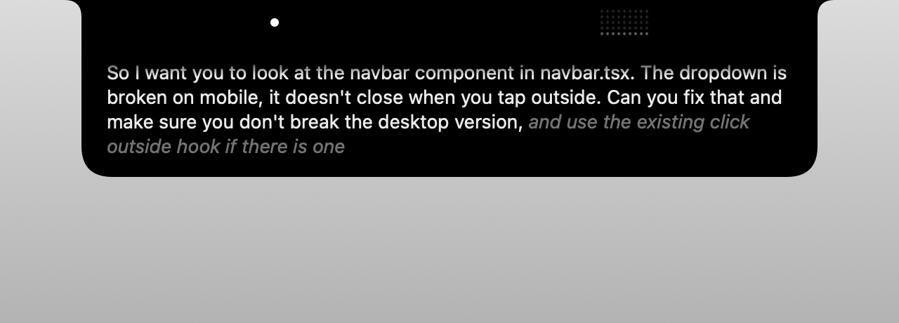

# Vox

**Talk. It types.**

> v3: your words appear in the notch *while you speak* (committed text solid, the words still being recognized in
> italic), and long dictations finish in under a second: Vox transcribes and polishes each phrase while you're
> still talking. A 55-second monologue goes from key-up to pasted text in ≈1.1 s.

Vox is a free, open-source, 100% on-device Wispr Flow alternative for macOS. Tap a key, speak messy, and clean text lands wherever your cursor is.

No account, no subscription, no word limits, no cloud. Your voice never leaves your Mac.

<p align="center"></p>

| | Wispr Flow | Vox |
|---|---|---|
| Price | $12–15/mo (free tier 2,000 words/week) | **$0, unlimited** |
| Speech-to-text | Cloud | Parakeet TDT on the Apple Neural Engine (~0.13 s for 15 s of audio) |
| AI cleanup (fillers, “actually 3”, lists, grammar) | Cloud LLM | Local Qwen3-4B via llama.cpp, or Apple Intelligence, with an output guard |
| Per-app styles | ✓ | ✓ AI & coding, Messages, Email, Docs, Other × Raw/Fast/Smart × Formal/Casual/Very casual |
| Command mode (edit selection by voice) | paid | ✓ |
| Learns from your corrections | ✓ | ✓ fix a word after it's pasted and it's added to your dictionary |
| “Press enter” to send | experimental | ✓ |
| Live transcript while you talk | — | ✓ in the notch: solid when final, *italic* while still being recognized |
| Time from key-up to text (55 s monologue) | several seconds | ≈1.1 s: phrases are transcribed and cleaned while you speak |
| Privacy | audio + context sent to servers | nothing leaves your Mac |

## Highlights

- **Streams while you speak.** A tiny voice-activity detector finds your pauses. Each phrase is transcribed by Parakeet on the Neural Engine and polished by the local LLM in the background. A pause to think doesn't end a sentence: unless the words say it ended, the phrases on both sides are heard again as one and cleaned together, so you never get "we should. Probably move it". The phrase you're still saying gets a cheap preview about once a second. On key-up only the last phrase is left, so long dictations finish as fast as short ones.
- **Notch island.** The recording UI grows out of the MacBook notch. It shows a dot-matrix level meter and up to four lines of live transcript, steps three dots while it finishes, and shows `+42` when the text lands. Displays without a notch get a black capsule under the menu bar.
- **Styles per app.** Prompts for Claude, Cursor or a terminal get lists and `backticks`. Discord gets casual (no final period). Email gets proper sentences.
- **Never loses a dictation.**
  - If you switched apps while it was thinking, the text goes to your clipboard and Vox says so.
  - ⌃⌘V pastes your last dictation again.
  - "Paste original" gives you exactly what you said.
  - History shows the raw and cleaned text side by side, with search.
- **AirPods-aware.** "Automatic" mic never uses a Bluetooth headset mic, so your music doesn't drop to call quality and your first words aren't clipped.
- **Ducks your music** while you talk and restores it afterwards, even after a crash.
- **Stats you'll want to post.** Words, WPM, streak and minutes saved, plus a one-click 1200×630 share card (copied to your clipboard and saved to your Desktop).
- **Fast paths.** Short replies skip the LLM. If the LLM takes longer than 4 s on a phrase, or its output doesn't look like what you said, the instant rule-based cleanup is used for that phrase.
- **Light on your Mac.**
  - Idle: no timers, no animation, no polling.
  - The speech model unloads after 10 idle minutes, and the LLM unloads after 10 by default.
  - The LLM loads only on first use, with a 2,048-token context and an 8-bit KV cache (≈420 MB less than v2).
  - While you talk, Vox uses ≈2% of one core for streaming (≈8% with the live preview on).

## Install

```bash
brew install llama.cpp        # free local LLM runtime for Smart cleanup
./scripts/build-app.sh        # builds, signs and installs /Applications/Vox.app
open /Applications/Vox.app
```

Onboarding walks you through Microphone, Accessibility and Input Monitoring, picking your key, and a practice box. Turn on Settings › General › **Open at login** so it is always ready. Tip: set System Settings → Keyboard → "Press 🌐 key to" → **Do Nothing**.

| Action | Keys (default trigger: fn) |
|---|---|
| Dictate | tap **fn**, talk, tap **fn** again to finish |
| Hold to talk (Settings › Shortcuts) | hold **fn**, talk, release; **double-tap fn** for hands-free |
| Command mode | select text, press **fn + ⇧**, say "make this shorter". With nothing selected, it writes new text |
| Send | end with "**press enter**" |
| Undo a sentence | "**scratch that**" |
| Paste last again | **⌃⌘V** |
| Cancel | **Esc** |

Every key is yours to change: Settings › **Shortcuts** records the dictation key (fn, or a left or right ⌘ ⌥ ⌃), paste last, paste original and cancel. Shortcuts remember which side you pressed, so left ⌘ ⌥ V leaves right ⌘ ⌥ V alone, and a matched shortcut never reaches the app. `Vox --test-keys` checks them all, including a live run of the event tap.

## How it's built

A native Swift/SwiftUI menu-bar app.

| File | What it does |
|---|---|
| `DictationController.swift` | The pipeline and state machine |
| `LiveDictation.swift` | Streaming: pause-aware segmenter, partial transcripts, and incremental per-sentence LLM cleanup; a pause to think never ends a sentence |
| `Overlay.swift` | The notch island |
| `Transcriber.swift` | FluidAudio / Parakeet |
| `LLM.swift` | llama-server child process with idle sleep and prompt-cache prewarm; Apple Foundation Models |
| `Prompts.swift`, `RuleCleaner.swift` | Cleanup prompts, rule-based cleanup and the output guard |
| `CorrectionLearner.swift`, `CorrectionWatcher.swift` | Learning from corrections (from BetterWispr, Apache-2.0) |
| `AudioDevices.swift` | Microphone choice and ducking |
| `MainWindow.swift`, `Onboarding.swift`, `Components.swift` | The app UI |

Self-tests, which need no mic or hotkey:

```bash
/Applications/Vox.app/Contents/MacOS/Vox --transcribe speech.wav Claude   # speech → cleanup, with timings
/Applications/Vox.app/Contents/MacOS/Vox --stream-test speech.wav Notes   # live pipeline at real-time pace: timeline, key-up→text latency, CPU
open -n -a Vox --args --mic-test speech.wav out.txt                       # plays the clip aloud, captures the real mic, saves out.txt.wav for replay
VOX_VAD_TRACE=1 /Applications/Vox.app/Contents/MacOS/Vox --stream-test out.txt.wav   # replay a capture with the VAD trace
/Applications/Vox.app/Contents/MacOS/Vox --test-text                      # tone, auto-send, scratch that, dictionary, phrase joining
/Applications/Vox.app/Contents/MacOS/Vox --render-ui /tmp/vox-ui          # renders UI states to PNG for design QA
```

## Credits

- [FluidAudio](https://github.com/FluidInference/FluidAudio): Parakeet on CoreML/ANE.
- [llama.cpp](https://github.com/ggml-org/llama.cpp), and [Qwen3](https://huggingface.co/Qwen) for cleanup.
- [BetterWispr](https://github.com/opennookorg/betterwispr) (Apache-2.0): correction learning.
- UI patterns from boring.notch, DynamicNotchKit and VoiceInk (numbers only; no GPL code). Design system shared with Tutto: monochrome ink, hairlines, engraved mono captions.

Vox is free.
